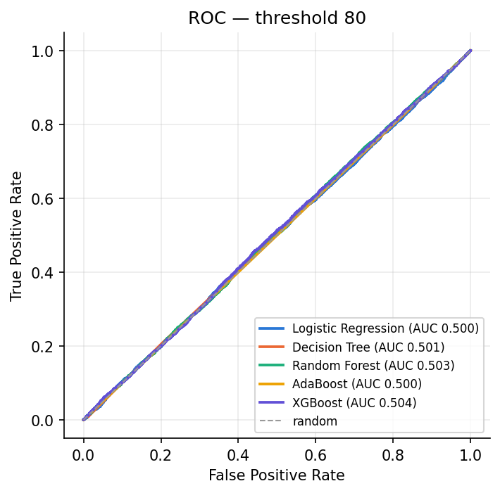
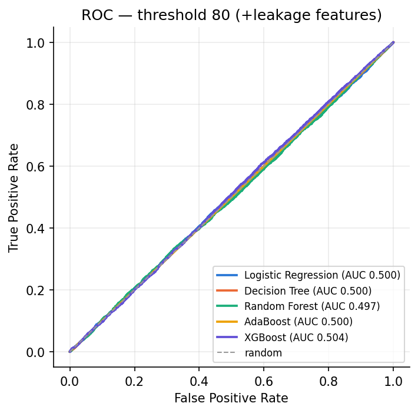

# 📱 Instagram Reels 바이럴 예측 (Virality Prediction)

> **Data Science** 최종 팀프로젝트 · **Team 6** · Ewha Womans University (Dept. of AI) · Spring 2026
> 5개 분류 모델을 **같은 전처리·같은 분할**로 비교하고, **"왜 바이럴 예측이 어려웠는가"** 를 데이터 관점에서 규명한 프로젝트


> 💡 **핵심 결론**: *"The limitation was not the model — it was the dataset."*
> 선형·트리·부스팅 어느 계열로 바꿔도 ROC-AUC가 0.5 근처에 머물렀고, 원인은 데이터셋 자체의 한계였다.
> 제출 후 확인한 사실: 이 데이터셋은 Kaggle 작성자가 **AI 보조·통계 규칙으로 생성한 합성(synthetic) 데이터**이고, 검증 결과 **타겟(`virality_score`)은 제거했던 engagement 변수를 포함한 모든 입력과 독립**이었다 ([아래 고찰](#-제출-후-고찰--합성-데이터라는-사실이-결론을-어떻게-바꾸는가)).

---

## 👤 담당 역할 — Dayeon Yu

> Team 6 (5인) · 아래는 본인이 담당한 파트

- **공통 전처리 파이프라인 구성 · 근거 문서화** — median imputation, stratified split, `random_state=42`를 5개 모델에 동일 적용해 **알고리즘 간 공정 비교의 기반**을 만듦 ([`docs/preprocessing_notes.pdf`](docs/preprocessing_notes.pdf))
- **Logistic Regression 담당** — baseline → `class_weight='balanced'` → GridSearchCV(`C`·`penalty`·`class_weight` 16조합, 5-fold Stratified) 튜닝, Accuracy/Precision/Recall/F1/ROC-AUC/Cross-Entropy 6개 지표 평가, 표준화 계수 해석으로 **선형 신호 부재** 입증 ([`notebooks/logistic_regression.ipynb`](notebooks/logistic_regression.ipynb)); 강의 개념(Lecture 2·4·5·6·7·10)과 1:1로 매핑한 주석판 작성 ([`logistic_regression_annotated.ipynb`](notebooks/logistic_regression_annotated.ipynb))
- **모델 비교 분석 · 추가 실험** — 5개 모델 결과 통합 비교, 클래스 불균형 가설을 검증하기 위한 **Threshold 조정 실험(80 → 60, Viral 20% → 40%)** 수행 → "F1은 오르지만 ROC-AUC는 0.5 그대로"를 확인해 *한계는 모델이 아니라 데이터*라는 결론 도출
- **발표** — 모델 설명·결과·모델 비교·추가 실험 파트 (Slides 8–18, [`docs/presentation_script.pdf`](docs/presentation_script.pdf))
- **제출 후 보완 (2026-11)** — 노트북마다 복사돼 있던 공통 전처리를 `src/preprocessing.py`로 모듈화, 5개 모델 최종 설정을 `src/models.py`에 고정, 한 번에 학습·비교·ROC 출력하는 `scripts/run_all_models.py` 작성 (threshold 실험 · 누수 변수 상한선 실험 · 신호 진단 포함), 합성 데이터 고찰 추가

---

## 📖 프로젝트 소개

- **주제**: Instagram Reels가 **바이럴(viral)** 될지 여부를 예측하는 이진 분류
- **목표**: 다양한 분류 모델을 **공정하게 비교**하고, 예측이 어려웠던 **근본 원인 규명**
- **강좌**: Data Science (Instructor: Hyunsoo Cho) — Spring 2026 Final Project · 평가 기준: Problem Definition 50% · Technical maturity 50%
- **접근의 차별점**: 단순 성능 경쟁이 아니라 **"모델이 실패한 이유"를 EDA로 역추적**한 분석형 프로젝트

---

## 🎯 문제 정의 & 데이터

- **문제 유형**: 이진 분류 (Viral `1` / Non-Viral `0`)
- **타겟 정의**: `virality_score >= 80` → Viral (1), 그 외 → Non-Viral (0) — Viral 비율 약 **20%**
- **데이터셋**: Kaggle [*What Makes an Instagram Reel Go Viral*](https://www.kaggle.com/datasets/deepeshkansotia/what-makes-an-instagram-reel-go-viral) — **100,000 × 26**, 1행 = 1 Reel, 작성자 설명에 따르면 **합성 데이터**

| 카테고리 | 변수 |
| --- | --- |
| Creator Information | `creator_followers` |
| Content Characteristics | `reel_length_sec`, `caption_length`, `hashtags_count`, `hook_strength_score`, `video_quality_score`, `editing_quality_score`, `audio_popularity_score`, `posting_time` |
| Viewer Behavior | `avg_watch_time_sec`, `retention_rate`, `completion_rate`, `rewatch_rate` |
| Exposure Signals | `non_follower_reach_ratio`, `trending_audio`, `explore_page_boost` |
| **제거 (누수)** | `likes`, `comments`, `shares`, `saves`, `impressions`, `reach`, `engagement_rate` — 업로드 *이후* 생성 |
| **제거 (ID)** | `reel_id`, `creator_id` — 각 100,000개 고유값 |

---

## 🧹 전처리 — 공통 파이프라인 (`src/preprocessing.py`)

> **왜 공통 전처리인가?** 모델마다 다른 전처리를 쓰면 성능 차이가 *알고리즘* 때문인지 *전처리* 때문인지 구분할 수 없다.
> → 모든 모델에 **동일 데이터셋 · 동일 누수 변수 제거 · 동일 결측치 처리 · 동일 Split · 동일 seed(42)** 를 적용했다.

1. `virality_score >= 80` → `viral_label` 생성 후 원본 점수 제거
2. 누수 변수 7개 + ID 2개 제거 → 남는 입력 16개 (수치형 14 + bool 2)
3. Stratified train/test split (80/20, `random_state=42`)
4. 수치형 결측 → `SimpleImputer(strategy='median')` (train 통계로 fit)
5. 범주형: ID 제거 후 남는 범주형 없음 → One-Hot 미수행 · Logistic Regression만 추가로 Z-score 표준화

---

## 🤖 모델별 결과 (Threshold = 80)

| 모델 | 설정 | Accuracy | F1 | ROC-AUC | 주요 발견 |
| --- | --- | --- | --- | --- | --- |
| Logistic Regression | `C=0.1`, L1, `class_weight=balanced` (GridSearchCV 5-fold) | 0.5026 | 0.2896 | 0.4997 | 선형 신호 거의 없음 (Recall 0.50, 표준화 계수 최대 ±0.012) |
| Decision Tree | `entropy`, `max_depth=7`, `min_samples_leaf=16`, balanced | 0.6767 | 0.2076 | 0.5008 | class weight로 Recall 0.003 → 0.21, 추가 튜닝 이득 없음 |
| AdaBoost | stump 기반, balanced sample weight | 0.2026 | 0.3365 | 0.4999 | Recall 0.999 — 거의 전부 Viral로 예측 (false positive 폭증) |
| Random Forest | 100 trees, `max_depth=10` | 0.7976 | 0.0000 | ≈ 0.50 | 전부 Non-Viral로 예측 (다수 클래스 편향) |
| XGBoost | `n_estimators=200`, `lr=0.05`, `max_depth=5`, `scale_pos_weight` | 0.8002 | 0.0000 | 0.5110 | 가장 강한 모델도 경계 학습 실패 |

⚠️ **공통 현상**: 모델 종류(선형·트리·부스팅)와 무관하게 **ROC-AUC ≈ 0.5** → 사실상 랜덤 추측 수준

**스크립트 재현** (`python scripts/run_all_models.py`, 2026-11 · [`results/model_comparison_th80.csv`](results/model_comparison_th80.csv))

| 모델 | Accuracy | F1 | ROC-AUC | Viral 예측 비율 | 팀 노트북 수치와 |
| --- | --- | --- | --- | --- | --- |
| Logistic Regression | 0.5026 | 0.2896 | 0.4997 | 49.8% | 소수점 4자리까지 일치 |
| Decision Tree | 0.6767 | 0.2076 | 0.5008 | 20.6% | 일치 |
| AdaBoost | 0.2025 | 0.3365 | 0.4998 | 99.96% | 일치 (Accuracy ±0.0001) |
| Random Forest (`class_weight=balanced`) | 0.6217 | 0.2394 | 0.5029 | 29.5% | 노트북은 balanced 미적용 버전(0.7976 / 0.00) |
| XGBoost (200 · 0.05 · depth 5 · `scale_pos_weight`) | 0.5498 | 0.2786 | 0.5042 | 42.2% | 노트북은 test로 early stopping한 버전(0.5110) |



---

## 🔬 추가 실험 — Threshold 조정 (80 → 60)

- 가설: *"진짜 문제는 심한 클래스 불균형 아닐까?"* → `virality_score` 임계값을 80 → 60으로 낮춰 Viral 비율 **20% → 40%**

| 모델 | F1 (80 → 60) | ROC-AUC (80 → 60) | 해석 |
| --- | --- | --- | --- |
| Logistic Regression | 0.2896 → 0.4440 | 0.4997 → 0.5001 | F1만 상승, 판별력 그대로 |
| Decision Tree | 0.2076 → 0.0000 | 0.5008 → 0.5000 | Viral 탐지 실패 |
| AdaBoost | 0.3365 → 0.0000 | 0.4999 → 0.5000 | 과다 예측 → 과소 예측으로 반전 |
| Random Forest | 0.0000 → 0.4481 | 0.5000 → 0.5012 | Viral을 잡기 시작하지만 분리력 약함 |
| XGBoost | 0.0000 → 0.5189 | 0.5110 → 0.5023 | F1 상승, false positive 증가 |

- **해석**: 균형을 맞추면 F1(점수)은 오르지만 **ROC-AUC(판별력)는 어떤 모델에서도 개선되지 않음** → 불균형은 근본 원인이 아님
- 스크립트 재현에서도 같은 패턴: 5개 모델 모두 F1은 +0.15~+0.36 오르고 AUC 변화는 −0.003~+0.002 ([`results/threshold_experiment.csv`](results/threshold_experiment.csv))

---

## 📊 Advanced EDA — 왜 모델이 실패했나

- **팔로워 규모**: 팔로워가 많아도 평균 Virality Score 차이는 미미 → `팔로워 수 ≠ 바이럴`
- **콘텐츠 특성**: 영상 길이·해시태그 수의 그룹 간 차이 무시할 수준
- **시청 행동**: Viral의 Retention이 높지만 **분포가 크게 중첩** → 단일 변수로 구분 불가
- **상관 분석**: 대부분 약한 상관, Virality와 강한 선형 관계를 갖는 변수 없음 (LR 기준 |corr| 최대 0.005)

### 🧩 근본 원인 3가지

1. **심한 클래스 불균형** (Viral 20% vs Non-Viral 80%)
2. **클래스 간 분포 중첩** (Viral/Non-Viral의 feature 범위가 유사)
3. **낮은 변수 분리력** (명확한 decision boundary 부재)

### 📉 Data Leakage 제거로 인한 정보 손실

- 발표 당시 해석: 제거된 변수(`likes`, `comments`, `shares`, `saves`, `reach`, `impressions`, `engagement_rate`)가 사실은 **바이럴 예측의 가장 강한 신호**였고, 누수를 막는 과정에서 예측력의 핵심 정보도 함께 사라졌다
- ⚠️ **제출 후 검증 결과 이 가설은 기각됐다.** 누수 변수 7개를 다시 포함해 학습해도 AUC는 0.497~0.504에 머물렀다 ([아래 고찰](#-제출-후-고찰--합성-데이터라는-사실이-결론을-어떻게-바꾸는가))

---

## 🧪 제출 후 고찰 — 합성 데이터라는 사실이 결론을 어떻게 바꾸는가

Kaggle 데이터 카드에는 *"This is a synthetic dataset generated using AI-assisted methods and statistical logic"* 이라고 적혀 있다. 발표 당시에는 이 점을 확인하지 못했다. 이 사실은 결론을 뒤집지는 않지만 **해석의 층위를 바꾼다.**

| 관점 | 발표 당시 해석 | 합성 데이터를 고려한 해석 |
| --- | --- | --- |
| AUC ≈ 0.5의 의미 | 메타데이터만으로는 실제 바이럴을 설명하기 어렵다 | 생성 규칙이 `virality_score`를 **모든 입력과 독립적으로** 만들었다(아래 실험 1·2로 확인) → 학습할 신호가 애초에 없다 |
| 누수 변수 제거 | 올바른 결정, 대신 정보 손실 | 여전히 올바른 결정. 그러나 "정보 손실"은 없었다 — **누수 변수에도 신호가 없다**(실험 1) |
| "데이터셋의 한계" | 콘텐츠 수준 정보 부재 | 그 전에 **데이터 생성 과정 자체**를 점검해야 했다 — 데이터 카드 확인은 EDA의 0단계 |

이 가설을 `scripts/run_all_models.py`의 두 실험으로 검증했다 (실행 결과는 [`results/`](results/)에 있다).

**실험 1 — 누수 변수 상한선** (`--leakage-upper-bound`, [`results/leakage_upper_bound.csv`](results/leakage_upper_bound.csv)): 제거했던 engagement 변수 7개를 *포함*해 같은 5개 모델을 다시 학습했다. `virality_score`가 engagement의 함수라면 AUC가 1.0에 가까워야 한다.

| 모델 | AUC (누수 변수 제외, 발표 설정) | AUC (누수 변수 포함) |
| --- | --- | --- |
| Logistic Regression | 0.4997 | 0.5000 |
| Decision Tree | 0.5008 | 0.5003 |
| Random Forest | 0.5029 | 0.4974 |
| AdaBoost | 0.4998 | 0.4998 |
| XGBoost | 0.5042 | 0.5041 |



→ **누수 변수를 넣어도 아무것도 달라지지 않는다.** "제거한 변수가 가장 강한 신호였다"는 발표의 주장은 틀렸다. `virality_score`는 likes·shares·reach와도 무관하게 생성됐다.

**실험 2 — 신호 진단** (`--diagnostics`, [`results/signal_diagnostics.csv`](results/signal_diagnostics.csv)): 남은 16개 피처의 단변량 AUC는 최대 0.510(`avg_watch_time_sec`), mutual information은 최대 0.009(`explore_page_boost`)다. 같은 GBDT를 **실제 라벨**로 학습하면 AUC 0.5039, **라벨을 무작위로 섞어** 학습하면 0.5030 — 차이 0.001. 남은 피처에 학습 가능한 신호가 없다는 영가설을 기각할 수 없다.

**수정된 결론**: 다섯 모델이 실패한 이유는 "콘텐츠 정보가 빠졌기 때문"이 아니라, **타겟이 모든 입력 변수와 독립인 합성 데이터**였기 때문이다. 어떤 모델·피처·threshold로도 0.5를 넘을 수 없는 문제였다. 팀의 결론 *"The limitation was not the model — it was the dataset"* 은 맞았지만, 그 이유는 발표 때 말한 것과 달랐다. 데이터 카드 확인과 라벨 섞기 기준선 비교는 모델을 다섯 개 돌리기 전에 했어야 할 10분짜리 작업이었다.

추가로 다음 버전에서 고칠 점:
- XGBoost 노트북이 `eval_set=[(X_test, y_test)]`로 early stopping을 했다 → test가 모델 선택에 쓰인 것이므로, validation split을 따로 두거나 CV 안에서 멈춰야 한다.
- Random Forest는 `class_weight`를 쓰지 않은 설정이 기록돼 있다 → `src/models.py`에서는 balanced로 통일했다.
- 결측 대체를 전체 데이터에 fit한 뒤 split했다 → `src/preprocessing.py`에서는 train 통계로만 fit한다.

---

## 💡 결론

| # | Finding |
| --- | --- |
| 1 | 대부분의 변수는 설명력이 낮았다 |
| 2 | Viral / Non-Viral 분포가 크게 중첩되었다 |
| 3 | 클래스 불균형이 예측을 더 어렵게 만들었다 — 하지만 근본 원인은 아니었다 (threshold 실험) |
| 4 | 데이터가 합성이었고, **타겟이 (제거한 engagement 변수를 포함한) 모든 입력과 독립**이어서 애초에 학습할 신호가 없었다 |

> **The limitation was not the model. The limitation was the dataset.**

---

## 🚀 향후 개선 방안

- **데이터**: 실제 수집 데이터(API·크롤링)로 교체하고, 데이터 카드 확인을 EDA 첫 단계로 고정
- **상호작용 피처**: `creator_followers × explore_page_boost → explore_effect_score`
- **콘텐츠 품질 지표**: `hook_strength + video_quality + editing_quality → content_quality_index`
- **시청 행동 통합 지표**: `retention + completion + rewatch → watch_behavior_score`
- **근본적으로**: 영상 내용·주제·감정·스토리텔링 등 **콘텐츠 자체 정보** 확보 필요

---

## 📂 프로젝트 구조

```
instagram-reels-virality-prediction/
├── README.md
├── src/
│   ├── preprocessing.py            # 공통 전처리 (타겟 생성 · 누수/ID 제거 · stratified split · median imputation)
│   ├── models.py                   # 5개 모델의 최종 설정 (LR · DT · RF · AdaBoost · XGBoost)
│   └── evaluate.py                 # 지표 표 · ROC 곡선 · 신호 진단
├── scripts/
│   └── run_all_models.py           # 5개 모델 일괄 학습·비교 → results/ (threshold 실험 · 상한선 실험 · 진단)
├── notebooks/
│   ├── ml_models_all.ipynb         # 5개 모델 통합 노트북 (팀 제출본)
│   ├── logistic_regression.ipynb   # LR 상세 분석 (결과·그래프 포함)
│   └── logistic_regression_annotated.ipynb  # LR + 강의 개념 매핑판
├── docs/
│   ├── project_description.pdf     # 과제 안내
│   ├── proposal.pdf                # 프로젝트 제안서
│   ├── preprocessing_notes.pdf     # 공통 전처리 근거 정리
│   ├── presentation.pdf            # 최종 발표자료 (31 slides)
│   └── presentation_script.pdf     # 발표 스크립트 (Slides 8–18)
├── results/                        # run_all_models.py 실행 결과 (표·그림)
├── data/README.md                  # 데이터 안내 (Kaggle, 원본 미포함)
├── requirements.txt
└── _posts/                         # 깃허브 블로그 포스트
```

---

## 🏃 실행 방법

```bash
git clone https://github.com/dayeon-yu/instagram-reels-virality-prediction.git
cd instagram-reels-virality-prediction
pip install -r requirements.txt

# Kaggle에서 데이터셋 다운로드 → data/instagram_data.csv 로 배치 (data/README.md 참고)

# 5개 모델 일괄 비교 (threshold 80·60, 누수 상한선 실험, 신호 진단까지 — 약 2~3분)
python scripts/run_all_models.py --data data/instagram_data.csv --thresholds 80 60 --leakage-upper-bound --diagnostics

# 개별 노트북
jupyter notebook notebooks/logistic_regression.ipynb
```

> 노트북은 Google Colab 기준으로 작성되어 있어, 로컬 실행 시 상단 `drive.mount(...)`와 데이터 경로를 수정해야 한다. 스크립트는 로컬/Colab 어디서나 그대로 실행된다.

---

## 📄 산출물 & 문서

- 🧩 [`scripts/run_all_models.py`](./scripts/run_all_models.py) — 5개 모델 재현 스크립트 · 실행 결과 [`results/`](./results/) (표 5개, ROC 3장)
- 📓 [`notebooks/ml_models_all.ipynb`](./notebooks/ml_models_all.ipynb) — 5개 모델 전체 파이프라인
- 📈 [`notebooks/logistic_regression.ipynb`](./notebooks/logistic_regression.ipynb) — LR 상세 (결과·그래프)
- 📑 [`docs/presentation.pdf`](./docs/presentation.pdf) — 최종 발표자료
- 📋 [`docs/proposal.pdf`](./docs/proposal.pdf) — 제안서
- ✍️ [블로그 포스트](./_posts/2026-06-17-instagram-reels-virality-prediction.md) — 프로젝트 회고

<div align="center">

**Data Science · Team 6 · Ewha W. University · 2026**

</div>
